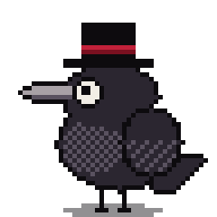
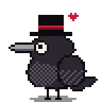
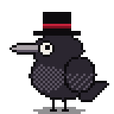
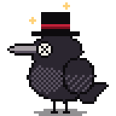
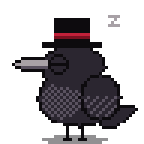
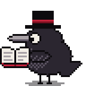
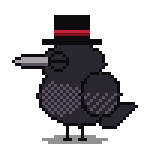
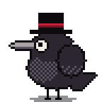
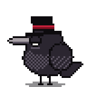
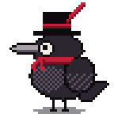

<div align="center">

<picture>
  <source media="(prefers-color-scheme: dark)" srcset="docs/assets/readme/hero-dark.png">
  
</picture>

# Mocha

**A tiny pixel-art raven that lives on your desktop and keeps you company.**

[](https://github.com/sudeatesoglu/mocha-desktop-companion/releases/latest)
[](https://github.com/sudeatesoglu/mocha-desktop-companion/actions/workflows/ci.yml)

</div>

## Meet Mocha

<table>
  <tr>
    <td align="center" width="25%">
      <picture>
        <source media="(prefers-color-scheme: dark)" srcset="docs/assets/readme/pet-dark.png">
        
      </picture>
      <br><b>Pet it</b><br>Move your cursor onto Mocha.
    </td>
    <td align="center" width="25%">
      <picture>
        <source media="(prefers-color-scheme: dark)" srcset="docs/assets/readme/watch-dark.png">
        
      </picture>
      <br><b>It watches you</b><br>Its eye follows your cursor anywhere.
    </td>
    <td align="center" width="25%">
      <picture>
        <source media="(prefers-color-scheme: dark)" srcset="docs/assets/readme/dizzy-dark.png">
        
      </picture>
      <br><b>Don't overdo it</b><br>Four quick clicks make it dizzy.
    </td>
    <td align="center" width="25%">
      <picture>
        <source media="(prefers-color-scheme: dark)" srcset="docs/assets/readme/sleep-dark.png">
        
      </picture>
      <br><b>Let it rest</b><br>Pause it from the menu bar.
    </td>
  </tr>
  <tr>
    <td align="center" width="25%">
      <picture>
        <source media="(prefers-color-scheme: dark)" srcset="docs/assets/readme/focus-dark.png">
        
      </picture>
      <br><b>Focus together</b><br>It reads while you work.
    </td>
    <td align="center" width="25%">
      <picture>
        <source media="(prefers-color-scheme: dark)" srcset="docs/assets/readme/breathe-dark.png">
        
      </picture>
      <br><b>Breathe with it</b><br>A short ritual in every break.
    </td>
    <td align="center" width="25%">
      <picture>
        <source media="(prefers-color-scheme: dark)" srcset="docs/assets/readme/stretch-dark.png">
        
      </picture>
      <br><b>Stretch with it</b><br>It does every step with you.
    </td>
    <td align="center" width="25%">
      <picture>
        <source media="(prefers-color-scheme: dark)" srcset="docs/assets/readme/tired-dark.png">
        
      </picture>
      <br><b>Mind its energy</b><br>Long stretches make it sleepy.
    </td>
  </tr>
</table>

Drag Mocha anywhere and it remembers the spot. It stays out of your way: clicks pass through everywhere except Mocha itself.

**Breaks, gently.** After 40 minutes of work a speech bubble next to Mocha suggests a 10-minute break. Take it, snooze it or skip it; the bubble never steals your keyboard. Mocha naps through every break, including when you step away; the menu bar and the Tower show how long it has left and let you end it early. Change the lengths or set quiet hours in **Settings**, and see today's active time, breaks and longest stretch at the top of the menu.

**A home of its own.** Double-click Mocha, or choose **Open Tower** in the menu bar, to visit its room. Mocha has a mood and an energy that follow your rest: energy drains while you work and comes back with every break, so a tired Mocha slumps and yawns on your desktop when you need a pause. Nothing bad ever happens if you forget about it. Pet it, give it a treat or rest together.

**Together.** Choose **Focus with Mocha** for a 25, 40 or 50-minute session: Mocha reads next to you, no reminder interrupts, and a break starts when the time is up. When a break starts, Mocha offers a short ritual in a bubble: breathe, rest your eyes or stretch, step by step, while Mocha does each step with you.

<picture>
  <source media="(prefers-color-scheme: dark)" srcset="docs/assets/readme/dressed-dark.png">
  
</picture>

**Make it yours.** Rest after real work fills a meter in the Tower, and every few breaks Mocha finds something: a scarf, a bow tie or a feather to wear, or a fern, a lantern or a crystal ball for its room. Click the Finds row to open the Collection, then dress Mocha up and decorate. Nothing can be bought or lost. The Tower's window follows your day, and a candle burns at night. In **Settings**, Mocha can open when you log in and play quiet sounds; both stay off until you turn them on.

**In your browser.** With the Mocha extension for Chrome and other Chromium browsers, Mocha keeps you company while you browse: it reads along in red glasses on code and docs, watches videos with a box of popcorn, bobs its head to music, gets shiny eyes on shopping sites and scribbles along when you type a lot. If you like, it says a playful word now and then, at most every ten minutes, and nudges you gently after a long scroll or past midnight; **Hush Mocha** in the menu bar quiets it. It knows only what you turn on in **Settings → Browser**, all off until then (see Your data below).

## Install

1. [Download the DMG](https://github.com/sudeatesoglu/mocha-desktop-companion/releases/latest) for your Mac (`arm64` for Apple Silicon) and drag **Mocha** into **Applications**.
2. Open Mocha. This early version isn't notarized by Apple yet, so the first time you'll need to allow it: **System Settings → Privacy & Security → Open Anyway**.
3. Look for the top hat in your menu bar. That is where you see today's numbers, start a focus session, open the Tower and Settings, pause and quit.

macOS only for now.

### The browser extension

1. Download `mocha-extension-<version>.zip` from the [same release](https://github.com/sudeatesoglu/mocha-desktop-companion/releases/latest) and unzip it.
2. In Chrome, open `chrome://extensions`, turn on **Developer mode** and choose **Load unpacked**, then the unzipped folder. Chrome asks for nothing yet; the extension's page opens and explains what Mocha may know.
3. In Mocha, open **Settings → Browser**, turn on **Let the Mocha extension connect**, choose what Mocha may know and do, and copy the pairing code.
4. Paste the code on the extension's page under **Pair with Mocha**. Chrome asks for its own permission there once something needs it.

To update, unzip the new version over the old folder and click the reload button on the extension's card in `chrome://extensions`.

## What's next

- [x] **v0.1 Hello, Mocha:** lives on your desktop and reacts to you
- [x] **v0.2 Healthy habits:** notices long stretches of work and reminds you to take a break
- [x] **v0.3 The Tower:** a larger Tamagotchi-style home with stats and actions
- [x] **v0.4 Together:** break rituals and working side by side
- [x] **v0.5 Make it yours:** decorations and accessories
- [ ] **v0.6 Shiny things:** a browser extension, so Mocha can keep you company in the browser and talk about what you do, with what it may know up to you
- [ ] **v0.7 Smart:** opt-in AI to chat with Mocha and get insights about your day
- [ ] **v1.0:** signed and notarized installers, automatic updates, Windows and Linux

See the [changelog](CHANGELOG.md) for what each release contains.

<details>
<summary><b>Your data</b></summary>
<br>

Mocha is local-first: it has no account and no telemetry. To notice when you step away it reads only how long it has been since your last keyboard or mouse input, never what you type, where you click or which apps you use.

The browser extension tells Mocha only what you turn on in **Settings**, all off until then: the kind of site you are on, its domain, the page title with addresses and numbers taken out, how busy the browser is, and how often you type, scroll and click on a page, as counts every 30 seconds, never what you type or click on, and never in password fields. It never sends anything from private windows, pages on your computer or network, banking, health, government, mail and messaging, password manager or adult sites, sign-in, checkout and account pages, or the sites you leave out. Mocha listens for it only while you let it connect, on your own computer only, and keeps only the latest page in memory, never on disk or in a log.

Mocha writes two things to `~/Library/Application Support/Mocha/`: `settings.json`, which holds where you placed it, your break settings, whether sounds are on, what Mocha wears and what stands in its room, and the browser extension's pairing code and what you let Mocha know, and `mocha.db`, which holds when your work stretches and breaks started and ended, Mocha's mood and energy, and what Mocha found, with nothing about what you do in them. Deleting them resets Mocha.

</details>

<details>
<summary><b>Verify a download</b></summary>
<br>

```bash
shasum -a 256 -c --ignore-missing SHA256SUMS.txt
```

This checks the files you downloaded are intact. Releases built by the release workflow (after v0.1.0) can also be traced to this repository:

```bash
gh attestation verify Mocha-<version>-arm64.dmg --repo sudeatesoglu/mocha-desktop-companion
```

The browser extension's zip, from v0.6.0, the same way:

```bash
gh attestation verify mocha-extension-<version>.zip --repo sudeatesoglu/mocha-desktop-companion
```

</details>

<details>
<summary><b>For developers</b></summary>
<br>

You need Node 24 (as in `.node-version`) and pnpm 12.

```bash
git clone https://github.com/sudeatesoglu/mocha-desktop-companion.git
cd mocha-desktop-companion
pnpm install
pnpm dev
```

Built with Electron, TypeScript and a small hand-written Canvas 2D engine. `pnpm lint && pnpm typecheck && pnpm test:coverage && pnpm build` runs every check, and `pnpm --filter @mocha/desktop generate:skin`, `generate:readme-art` and `generate:icon` redraw the placeholder skin, the README art and the app icon. Run them on Node 24: other versions compress the same pixels into different PNG bytes. In development, `MOCHA_DEV_WORK_MS=60000 pnpm dev` shortens the work stretch and `MOCHA_DEV_FOCUS_MS=60000` every focus session, so reminders and breaks can be tried without waiting. Development keeps its data in `~/Library/Application Support/Mocha Dev`, apart from the installed app's.

- [Skin format](docs/skins.md): how to draw your own Mocha
- [Architecture decisions](docs/adr/README.md): why it is built this way

Mocha is a personal project and is not open to code contributions: pull requests from others are not merged. Bug reports and ideas are welcome as [issues](https://github.com/sudeatesoglu/mocha-desktop-companion/issues/new/choose).

</details>

<div align="center">

Mocha grew out of my ink drawings. See more of my art on Instagram: [@ravenoushout](https://www.instagram.com/ravenoushout/).

</div>
