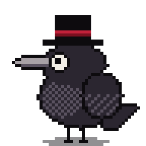
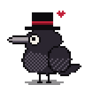
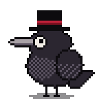
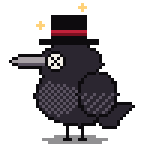
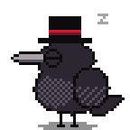

<div align="center">

<picture>
  <source media="(prefers-color-scheme: dark)" srcset="docs/assets/readme/hero-dark.png">
  
</picture>

# Mocha

**A tiny pixel-art raven that lives on your desktop and keeps you company.**

[](https://github.com/sudeatesoglu/mocha-desktop-companion/releases/latest)
[](https://github.com/sudeatesoglu/mocha-desktop-companion/actions/workflows/ci.yml)

</div>

## Meet Mocha

<table>
  <tr>
    <td align="center" width="25%">
      <picture>
        <source media="(prefers-color-scheme: dark)" srcset="docs/assets/readme/pet-dark.png">
        
      </picture>
      <br><b>Pet it</b><br>Move your cursor onto Mocha.
    </td>
    <td align="center" width="25%">
      <picture>
        <source media="(prefers-color-scheme: dark)" srcset="docs/assets/readme/watch-dark.png">
        
      </picture>
      <br><b>It watches you</b><br>Its eye follows your cursor anywhere.
    </td>
    <td align="center" width="25%">
      <picture>
        <source media="(prefers-color-scheme: dark)" srcset="docs/assets/readme/dizzy-dark.png">
        
      </picture>
      <br><b>Don't overdo it</b><br>Four quick clicks make it dizzy.
    </td>
    <td align="center" width="25%">
      <picture>
        <source media="(prefers-color-scheme: dark)" srcset="docs/assets/readme/sleep-dark.png">
        
      </picture>
      <br><b>Let it rest</b><br>Pause it from the menu bar.
    </td>
  </tr>
</table>

Drag Mocha anywhere and it remembers the spot. It stays out of your way: clicks pass through everywhere except Mocha itself.

## Install

1. [Download the DMG](https://github.com/sudeatesoglu/mocha-desktop-companion/releases/latest) for your Mac (`arm64` for Apple Silicon) and drag **Mocha** into **Applications**.
2. Open it. The first time, macOS blocks it because it is not signed with an Apple Developer ID yet: go to **System Settings → Privacy & Security** and click **Open Anyway**.
3. Look for the top hat in your menu bar. That is where you pause, reset and quit.

macOS only for now.

## What's next

- [x] **v0.1 Hello, Mocha:** lives on your desktop and reacts to you
- [ ] **v0.2 Healthy habits:** notices long stretches of work and reminds you to take a break
- [ ] **v0.3 The Tower:** a larger Tamagotchi-style home with stats and actions
- [ ] **v0.4 Together:** break rituals and working side by side
- [ ] **v0.5 Make it yours:** decorations and accessories

See the [changelog](CHANGELOG.md) for what each release contains.

<details>
<summary><b>Your data</b></summary>
<br>

Mocha is local-first: it has no account and no telemetry. The only file it writes itself is `~/Library/Application Support/Mocha/settings.json`, which holds where you placed it. Deleting that file resets Mocha's position.

</details>

<details>
<summary><b>Verify a download</b></summary>
<br>

```bash
shasum -a 256 -c SHA256SUMS.txt
```

This checks the file is intact. Releases built by the release workflow (after v0.1.0) can also be traced to this repository:

```bash
gh attestation verify Mocha-<version>-arm64.dmg --repo sudeatesoglu/mocha-desktop-companion
```

</details>

<details>
<summary><b>For developers</b></summary>
<br>

```bash
git clone https://github.com/sudeatesoglu/mocha-desktop-companion.git
cd mocha-desktop-companion
pnpm install
pnpm dev
```

Built with Electron, TypeScript and a small hand-written Canvas 2D engine.

- [Contributing](CONTRIBUTING.md): setup, scripts and workflow
- [Skin format](docs/skins.md): how to draw your own Mocha
- [Architecture decisions](docs/adr/README.md): why it is built this way

</details>

<div align="center">

Mocha grew out of my ink drawings. See more of my art on Instagram: [@ravenoushout](https://www.instagram.com/ravenoushout/).

</div>
